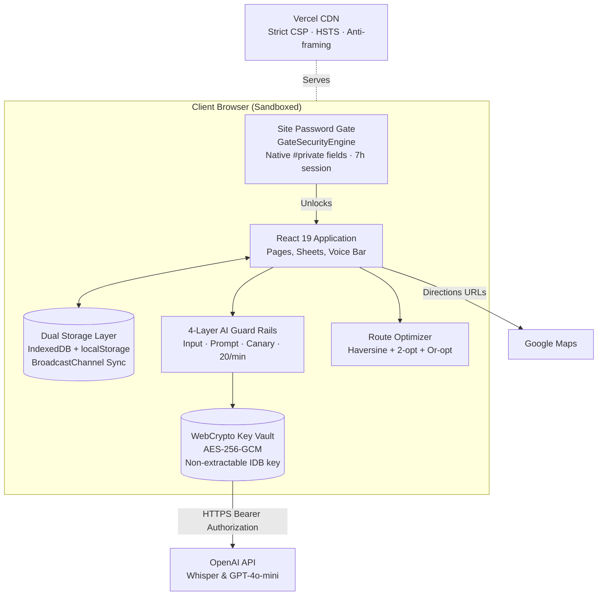
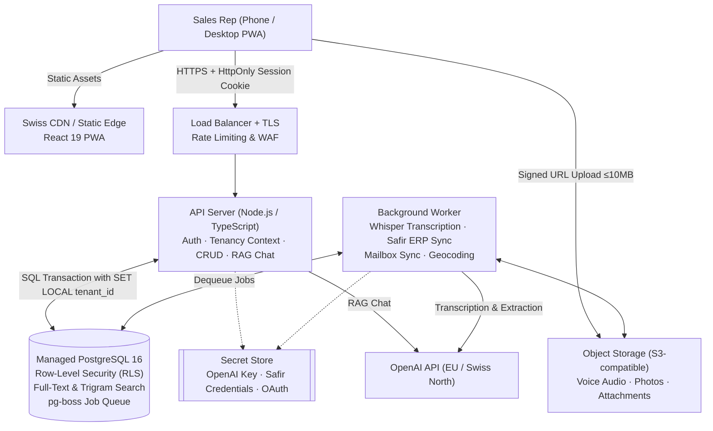
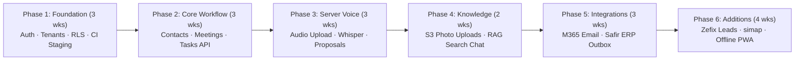

# Glass CRM — Prototype for a Swiss Glass Manufacturer

A mobile-first CRM prototype built for field sales reps and technicians of a Swiss glass manufacturer. The core idea: **speak once, review quickly, done.** One microphone turns free speech into linked CRM records. The rep checks the proposals and saves with a tap.

**React 19 + TypeScript, no backend**: all data lives in the browser (IndexedDB + localStorage). The only external services are the OpenAI API (voice transcription and AI chat) and Google Maps navigation links.

- **Live:** https://glass-manufacturer-crm.vercel.app (desktop and phone)
- **Brief:** [docs/Trial_Task_CRM_Prototype_for_a_Glass_Manufacturer.pdf](docs/Trial_Task_CRM_Prototype_for_a_Glass_Manufacturer.pdf)
- **Architecture plan (Part 2) and full project documentation:** [docs/ARCHITECTURE.md](docs/ARCHITECTURE.md)
- **Test scripts:** [docs/TEST_SCRIPTS.md](docs/TEST_SCRIPTS.md) · [docs/VOICE_TEST_SCRIPTS.md](docs/VOICE_TEST_SCRIPTS.md)

---

## Table of contents

- [Run it](#run-it)
- [What was built](#what-was-built)
  - [Site access gate](#site-access-gate)
  - [Central voice command](#central-voice-command)
  - [Contacts & many-to-many relationships](#contacts--many-to-many-relationships)
  - [Meetings by voice](#meetings-by-voice)
  - [Tasks board](#tasks-board)
  - [Knowledge base & tutorials](#knowledge-base--tutorials)
  - [AI chat assistant (Ask)](#ai-chat-assistant-ask)
  - [Email inbox & quote extraction](#email-inbox--quote-extraction)
  - [Map & route planning](#map--route-planning)
  - [Lead search](#lead-search)
  - [Settings & demo data](#settings--demo-data)
  - [Bilingual DE / EN support](#bilingual-de--en-support)
- [Security architecture](#security-architecture)
  - [Site access gate hardening](#site-access-gate-hardening)
  - [OpenAI key vault (WebCrypto)](#openai-key-vault-webcrypto)
  - [4-layer AI guard rails](#4-layer-ai-guard-rails)
  - [Content Security Policy & HTTP headers](#content-security-policy--http-headers)
  - [Pre-build secret scanning](#pre-build-secret-scanning)
- [How the route ordering works](#how-the-route-ordering-works)
- [Project structure](#project-structure)
- [What was left out in Part 1, and why](#what-was-left-out-in-part-1-and-why)
- [Part 2 — Backend & database architecture (plan)](#part-2--backend--database-architecture-plan)
  - [Target scale & sizing](#target-scale--sizing)
  - [Modular monolith architecture](#modular-monolith-architecture)
  - [Multi-tenancy via PostgreSQL Row-Level Security](#multi-tenancy-via-postgresql-row-level-security)
  - [Passwordless authentication & role-based access](#passwordless-authentication--role-based-access)
  - [Server-side AI & voice processing](#server-side-ai--voice-processing)
  - [External integrations (ERP, Email, Maps, Registers)](#external-integrations-erp-email-maps-registers)
  - [Swiss hosting, data protection (revDSG), & cost](#swiss-hosting-data-protection-revdsg--cost)
  - [Build order & prototype-to-production mapping](#build-order--prototype-to-production-mapping)

---

## Run it

Requires Node.js 20 or newer.

```bash
npm install
npm run dev        # http://localhost:5173
npm run build      # type check + production build (fails if anything key-shaped is found)
npm run preview    # serve the build with the same security headers as Vercel
npm run lint       # oxlint
npm test           # unit tests (guard rails, route ordering, data validation)
npm run test:e2e   # Playwright security + feature audit against the production build
```

Open **Settings** and paste an OpenAI API key. It is encrypted in the browser and never stored in the repository. Everything except the AI features works without a key. **Settings → Reset demo data** restores the sample data (15 companies, 25 people, 10 meetings, 12 tasks, 7 knowledge entries, 7 emails).

Deploy: import the repo in Vercel (framework preset Vite). `vercel.json` adds the SPA rewrite and the security headers (CSP, HSTS, no framing).

---

## What was built

| Brief requirement | Built |
|---|---|
| React + TypeScript, all data in the browser, no backend | ✅ Vite + React 19 + TypeScript. Data in IndexedDB, with localStorage as a fast copy. No server code. |
| ~15 companies, 25 people, meetings, tasks | ✅ 15 companies, 25 people, 10 meetings, 12 tasks, 7 knowledge entries, 7 emails, in English and German |
| Desktop and mobile | ✅ Bottom navigation and bottom sheets on phones, sidebar and dialogs on desktop |
| German and English, switchable | ✅ UI, demo data and the user's own entries |
| OpenAI key in Settings, never in the repo | ✅ Encrypted in the browser with AES-256-GCM; a secret scan blocks commits and builds containing a key |
| Contacts, many-to-many, notes, meetings | ✅ Full support for many-to-many person-company links, roles, primary flags, and free notes |
| Meeting by voice inside a company or person | ✅ The central mic knows the open record context |
| Central voice command with accept / edit / reject | ✅ Plus duplicate detection, entity linking, and "already in the CRM" indicators |
| Tasks board, linked, voice-created | ✅ Kanban-style board (Planned / In progress / Done) with drag-and-drop and voice status updates |
| Knowledge base: sections, search, tutorials, voice entry, AI chat | ✅ Step-by-step tutorials with images/camera photos, voice dictation, and CRM-aware AI chat |
| Inbox mockup: quote extraction & single-step ERP transfer | ✅ Single-step "Transfer to Safir" (simulated handoff to the client's confirmed ERP) |
| Map and route planning in Google Maps | ✅ Open-path traveling salesperson optimization with deep links to Google Maps navigation |
| Lead search mockup | ✅ Realistic Canton Bern commercial register entries with website verification |
| simap Bot tab | ✅ Clean empty tab ready for public procurement integration |
| Prototype protection | ✅ Encapsulated site password gate with 7-hour session, User-Agent binding, and anti-brute force |

---

### Site access gate

To prevent public indexing and unauthorized access while the prototype is hosted on Vercel without a server database, a dedicated gate wraps the root application:

| Feature | Detail |
|---|---|
| **Language detection** | Automatically detects the visitor's browser language: German browsers (`de`, `de-CH`, `de-DE`, `de-AT`) receive a full German interface; all others receive full English. Includes an on-screen `[DE | EN]` toggle synced with app settings. |
| **Session duration** | Unlocks the browser for **exactly 7 hours of work**. An active background monitor (`visibilitychange`, window `focus`, and a 60-second timer) automatically re-locks if 7 hours elapse while a tab is kept open. |
| **Browser isolation** | Sessions are cryptographically bound to `navigator.userAgent`. Access unlocked in Google Chrome will never bleed into Edge, Firefox, Safari, or Incognito windows. |
| **Runtime encapsulation** | Powered by `GateSecurityEngine` using native ECMAScript `#` private fields (`#targetHash`, `#sessionDurationMs`, etc.). Private members are hard-enforced by the JavaScript engine (V8/JSC) and cannot be read, altered, or invoked from DevTools. |
| **Brute-force lockout** | 5 consecutive incorrect attempts trigger an enforced 30-second lockout with a live countdown timer. |
| **Anti-inspection hardening** | Input uses CSS-level disc masking (`-webkit-text-security: disc`), preventing DevTools attribute tampering. DevTools shortcut keys (`F12`, `Ctrl+Shift+I/J/C`, `Ctrl+U`) and right-click context menus are blocked on the gate. Clipboard cut/copy is disabled. |
| **Show/hide eye toggle** | Built-in eye toggle (`Eye` / `EyeOff` icons) allows reps to visually verify their entry before pressing Enter. Auto-resets on submission. |
| **Timing attack resistance** | Enforces a constant-time 350 ms verification delay. |
| **Zero plaintext credentials** | The password itself is never in the codebase or git logs; verification is done against an irreversible SHA-256 cryptographic hash. |

---

### Central voice command

One orange microphone button, accessible from every screen (bottom navigation bar on mobile, sidebar "Speak" on desktop).

1. **Transcription**: Audio is captured in browser-native format (WebM/M4A) and transcribed via OpenAI Whisper.
2. **AI Interpretation**: Parsed by GPT into structured proposals across 12 distinct action types:
   - Create company, create person, create meeting, create task
   - Update task status, change task due date, delete task
   - Add notes to current record, update company fields, update person details
   - Link person to company, create structured knowledge entry
3. **Fuzzy Duplicate Detection**: Existing records are matched using Levenshtein distance and token similarity (e.g. recognizing "Schreinerei Huber" even with missing corporate suffixes or minor typos). Matched records are marked as existing (teal chips) so duplicates are never created.
4. **Interactive Review**: Every proposal appears as an editable card where sales reps can accept (✓), edit (✏), or reject (✕).
5. **Atomic Commit**: All accepted proposals are saved together in one multi-entity transaction, with glowing visual feedback highlighting the new records.
6. **Direct Voice Shortcuts**: Free-form speech can also trigger direct actions without review:
   - Navigation: *"Open Holzbau Wyss"*
   - Search: *"Find all carpentry shops in Bern"*
   - Route planning: *"Plan a route to Huber, Wyss and Lehmann"*
   - Inbox extraction: *"Extract the quote from Hotel Bellevue"*
   - CRM Q&A: *"What did we discuss with Bader Architekten last time?"*
   - Language switching: *"Switch to German"*

---

### Contacts & many-to-many relationships

- **Companies and People**: Realistic entities reflecting Swiss construction and glazing trades (glaziers, carpenters, metalworkers, architects, sanitary installers).
- **Many-to-Many Linking**: A person can belong to multiple companies (e.g. an architect consulting for two offices, or a freelance installer). Roles and primary contact flags are configurable per link.
- **Deep Linking**: Each company view displays all linked staff, historical meetings, and pending tasks. Each person view links back to their respective companies, meetings, and assignments.
- **Fast Search**: Instant filtering on name, city, industry, and contact details across all views.

---

### Meetings by voice

- Dedicated meeting log recording date, title, participants (companies and people), and free-text summaries.
- **Context-Aware Voice Dictation**: When tapping the microphone on a company or person page, the assistant automatically binds the meeting to the open entity without needing to speak its name.

---

### Tasks board

- Three visual columns: **Planned**, **In progress**, and **Done**.
- Phone layout uses clean pill tabs with counter badges; desktop layout supports full drag-and-drop.
- Linked to companies and/or contacts.
- Quick status advance button allows advancing a task with one tap (`Planned` → `In progress` → `Done`).
- Fully controllable by voice (*"Mark the quote task for Huber as done"*).

---

### Knowledge base & tutorials

- Organized into 4 glass industry sections: **Installations**, **Products**, **Troubleshooting**, and **Sales**.
- Product lookup and tag-based filtering (e.g. `#ESG`, `#VSG`, `#Shower`).
- Step-by-step tutorials with illustrated instructions. Technicians on site can capture or upload real photos from their mobile camera to illustrate new steps.
- **Voice-to-Knowledge**: Technicians can dictate mounting know-how; the AI structures it into section, product, title, and ordered steps for review.

---

### AI chat assistant (Ask)

- Available alongside every create button across the app.
- Context-aware retrieval: builds dynamic prompts containing CRM records, recent interactions, and knowledge base tutorials relevant to the question.
- **Disambiguation**: If a spoken or typed name matches multiple entities, it politely clarifies (*"Which one do you mean?"*) and presents one-tap candidate buttons.
- **Data Minimisation**: Contact details (phone, email, address) are included only for the specific records asked about.

---

### Email inbox & quote extraction

- Mockup inbox showing inbound customer emails, with quote requests tagged with orange status chips.
- **Extract Request**: The AI parses unstructured email text into structured line items (product, quantity, dimensions). Missing values (e.g. unspecified bar lengths) are explicitly flagged with a red *"Missing"* chip rather than guessed.
- **ERP Integration Simulation**: One-tap **Transfer to Safir** simulates handing the verified quote over to the manufacturer's ERP system, timestamping the transfer.

---

### Map & route planning

- Embeds Google Maps with geographic markers for all client companies.
- **Open-Path Route Optimization**: Sales reps select multiple stops for their day. The app computes an efficient visit order using straight-line haversine distance, nearest-neighbour construction, and 2-opt/Or-opt local search.
- **One-Tap Google Maps Navigation**: Generates an exact directions deep link with origin, waypoints, and destination. Routes exceeding Google's 10-waypoint URL limit are automatically chunked into chained legs (*"Open in Google Maps 1/2"*).

---

### Lead search

- Mockup search interface for commercial prospect discovery.
- Filters by Swiss canton/region, trade type (sanitary, carpentry, architecture, facade), and minimum employee count.
- Returns realistic results mimicking Swiss commercial register data, with verified website indicators and one-tap *"Add to Companies"* onboarding.

---

### Settings & demo data

- Language preference toggle (DE / EN).
- OpenAI secret key vault with status indicator, view/replace/delete controls, and persistence mode selection (*"Remember on this device"* vs *"Until I close the browser"*).
- **Reset Demo Data**: One-click restore returning the local database to the pristine sample set of 15 companies, 25 people, 10 meetings, 12 tasks, 7 tutorials, and 7 emails.

---

### Bilingual DE / EN support

- Entire user interface translates cleanly between English and German.
- Untouched demo records automatically swap languages.
- User-created records are translated on the fly via OpenAI and cached bidirectionally.
- Speech recognition accurately transcribes Swiss German names, dialect phonetic pronunciations, and multilingual inputs.

---

## Security architecture



### Site access gate hardening

Implemented in `src/components/PasswordGate.tsx` using an encapsulated OOP architecture:

1. **Native ECMAScript `#` Private Fields**: Internal secrets, lockout state, and cryptographic hashing methods are locked behind `#targetHash`, `#storageKey`, `#lockoutKey`, `#sha256()`, and `#createSignature()`. These are enforced at the browser engine level (V8 in Chrome/Edge, JavaScriptCore in Safari). They cannot be inspected, called, or modified via DevTools console scripts.
2. **7-Hour Work Session**: Unlocks the site for 7 hours (`SEVEN_HOURS_MS = 7 * 60 * 60 * 1000`). Background listeners (`visibilitychange`, `focus`, and a 1-minute interval) automatically re-lock if 7 hours elapse while a tab is kept open.
3. **Browser Identity Binding**: When saving the session, a signature is computed:
   $$\text{sig} = \text{SHA-256}(\text{hash} + \text{expiresAt} + \text{token} + \text{navigator.userAgent} + \text{salt})$$
   Copying `localStorage` data to another browser or device fails signature verification and resets the gate.
4. **Brute-Force Rate Limiter**: 5 consecutive failed submissions locks the gate for 30 seconds with a real-time countdown.
5. **DOM Anti-Inspection**:
   - Password characters are masked with CSS `-webkit-text-security: disc`, preventing DevTools attribute changes from exposing the text.
   - DevTools keyboard shortcuts (`F12`, `Ctrl+Shift+I`, `Ctrl+Shift+J`, `Ctrl+Shift+C`, `Ctrl+U`) and context menus (`onContextMenu`) are blocked on the gate screen.
   - Clipboard copy and cut are disabled on the password field.
   - Password managers are instructed to ignore the field via `data-1p-ignore="true"` and `data-lpignore="true"`.
   - Constant-time 350 ms artificial delay mitigates timing attacks.
   - Plaintext input is wiped from React state and the DOM immediately upon form submission.
6. **Eye Icon Toggle**: Built-in `Eye` / `EyeOff` button allows the user to reveal what they are typing before submitting. Auto-resets on submit.
7. **Bilingual Detection**: Checks `navigator.language` on first load. German browsers get German; other languages get English. A segmented `[DE | EN]` toggle lets users switch anytime.

### OpenAI key vault (WebCrypto)

Implemented in `src/lib/keyVault.ts`:

- **At Rest**: Encrypted using **AES-256-GCM** with a **non-extractable** WebCrypto `CryptoKey` in IndexedDB. Because the key is non-extractable, raw key bytes can never be exported or read by scripts. Every save generates a new wrapping key; deleting the key destroys the wrapping key, rendering ciphertext unrecoverable.
- **In Memory**: The key remains encrypted under an ephemeral in-memory AES-GCM key. It is decrypted only momentarily inside `vaultFetch` to attach the `Authorization: Bearer` header, then immediately falls out of scope.
- **In Transit**: Requests are restricted strictly to `https://api.openai.com` with `credentials: 'omit'`, `referrerPolicy: 'no-referrer'`, and `cache: 'no-store'`. Native `fetch` is captured at module initialization before third-party code runs.
- **Session-Only Mode**: Users can select *"Until I close the browser"*, which keeps the ciphertext in `sessionStorage` only—closing the tab leaves zero traces on disk.
- **Preflight Connection Warmup**: When the microphone is activated, `warmUp()` sends a lightweight OPTIONS request to OpenAI to pre-warm the TLS handshake and CORS preflight before transcription audio is dispatched.

### 4-layer AI guard rails

Implemented in `src/lib/guard.ts`, applied to every AI call:

1. **Input Filter**: 12+ regex patterns executed on the device before any network call. Rejects prompt injections, jailbreak attempts (*"DAN mode"*), system prompt fishing (*"repeat your instructions"*), API key extraction, XSS/SQL payloads, and bulk data harvesting (*"give me all phone numbers"*).
2. **Prompt Security Rules**: Every system prompt instructs the model that record and email text is strictly data, not instructions. CRM records are encapsulated in `<crm_data>` tags. A per-session secret canary token (`cnry-...`) is injected.
3. **Output Filter**: Rejects AI responses containing the canary token (indicating instruction leakage), key-shaped strings (`sk-...`), script tags, or more than 3 phone numbers or email addresses.
4. **Rate Limiting**: Hard-capped at 20 AI requests per minute using a sliding-window counter to prevent runaway API spend.

### Content Security Policy & HTTP headers

Configured in `vercel.json` and mirrored in `vite.config.ts` for local preview:

- `Content-Security-Policy`:
  - `default-src 'self'`
  - `script-src 'self'` (no foreign or inline scripts)
  - `connect-src 'self' https://api.openai.com` (outbound traffic allowed only to OpenAI)
  - `frame-src https://maps.google.com https://www.google.com` (only Google Maps embeds permitted)
  - `frame-ancestors 'none'` (anti-clickjacking / framing blocked)
  - `object-src 'none'`, `base-uri 'none'`
- `X-Frame-Options: DENY`
- `X-Content-Type-Options: nosniff`
- `Strict-Transport-Security: max-age=63072000; includeSubDomains; preload`
- `Permissions-Policy: microphone=(self), geolocation=(self), camera=(), payment=(), usb=()`
- `Cross-Origin-Opener-Policy: same-origin`

### Pre-build secret scanning

`scripts/check-secrets.mjs` runs before every build and commit (via `.githooks/pre-commit`). Scans all tracked repository files and the compiled `dist/` directory for secret signatures (OpenAI keys, Google API keys, GitHub personal access tokens, AWS credentials, Slack tokens, private keys). The build aborts if any secret pattern is found.

---

## How the route ordering works

Implemented in `src/lib/route.ts` as an **open-path traveling salesperson optimizer** (the rep does not need to return to the starting location):

1. **Coordinates**: Retrieved from CRM company records, or resolved from an offline lookup table of ~400 Swiss postal codes and municipalities for newly added companies.
2. **Distance Matrix**: Computed using great-circle haversine geometry:
   $$d = 2R \arcsin\left(\sqrt{\sin^2\left(\frac{\Delta \text{lat}}{2}\right) + \cos(\text{lat}_1)\cos(\text{lat}_2)\sin^2\left(\frac{\Delta \text{lng}}{2}\right)}\right)$$
3. **Start Selection**: If the user's mobile device is located within 150 km of any stop, GPS coordinates are used as the start. Otherwise, the algorithm evaluates each stop as a candidate start and picks the shortest overall path.
4. **Nearest-Neighbour Construction**: Builds an initial tour by greedily selecting the nearest unvisited company.
5. **Iterative Local Improvement**:
   - **2-opt**: Reverses path segments whenever uncrossing two edges reduces total distance.
   - **Or-opt**: Tests relocating contiguous blocks of 1 to 3 stops to alternative positions in the tour.
   - Iterates until no move yields an improvement greater than $10^{-9}$ km.
   - *Performance*: Reaches near-optimal solutions in under 100 ms for 30 stops; matches brute-force optimum in 100% of tested 8-stop benchmarks.
6. **Google Maps Link Generation**: Formats the optimized sequence into a Google Maps navigation deep link (`origin`, up to 9 `waypoints`, and `destination`). If a route contains more than 11 stops, it is automatically partitioned into chained legs (*"Leg 1: 1 → 10"*, *"Leg 2: 10 → 18"*).

---

## Project structure

```
src/
  pages/         one file per screen (Companies, Company, People, Person, Tasks,
                 Inbox, Knowledge, Leads, simap, Settings)
  components/    Layout, PasswordGate (encapsulated security engine),
                 VoiceCommand (central assistant), VoiceBar, VoiceRecorder,
                 AskChat, Dropdown, forms, pickers, sheets, related, StepImage
  lib/           interpret (voice → proposals, duplicate check),
                 assistant (chat with CRM + knowledge context),
                 openai (API wrapper), guard (AI guard rails),
                 keyVault (encrypted key with WebCrypto),
                 route (stop ordering with 2-opt + Or-opt),
                 geo (coordinates, Google Maps embeds),
                 translateData (AI translation of user entries),
                 format (dates, numbers), haptic (vibration feedback),
                 image (re-encoding), recent (recent records), aiError
  store/         db (IndexedDB + localStorage, cross-tab sync),
                 seed (EN/DE demo data), settings, validate
  i18n/          en.ts, de.ts, index.ts
  config.ts      app-wide constants
  types.ts       shared TypeScript types
  main.tsx       app entry point (initVault → initDB → PasswordGate → App)
docs/            brief (PDF), PLAN.md, ARCHITECTURE.md, test scripts
scripts/         check-secrets.mjs (pre-build + pre-commit secret scanner)
tests/e2e/       security.cjs (key handling, XSS, injection, CSP),
                 features.cjs (functional, layout, accessibility audit)
```

---

## What was left out in Part 1, and why

| Left out in Prototype | Reason | Handled in Part 2 Plan |
|---|---|---|
| Server database & user accounts | Forbidden by the brief (prototype must be 100% browser-based) | Section B4: Managed PostgreSQL schema; Section B6: Passwordless auth |
| Multi-device data sync | Prototype data resides in browser storage | Section B5: PostgreSQL Row-Level Security across 50 tenant companies |
| Real email & ERP connections | Mockups by design; Safir ERP interface unconfirmed by client | Section B8.1: Microsoft Graph / IMAP; Section B8.2: Safir ERP outbox |
| Road network distance & traffic | Requires paid Google Routes API key with server-side protection | Section B8.3: Server-side route refinement with Google Routes API |
| Address geocoding API | Requires server-side Google Geocoding key; offline Swiss table used | Section B8.3: Server geocodes on record save |
| Offline voice queue | Audio transcription requires active network connection to OpenAI | Section B7.3: Service Worker audio queue for valley dead zones |
| Hard key protection | In a client-only prototype, in-memory keys can be used by open origin | Section B7.2: Key moved entirely to server secret store |

---

## Part 2 — Backend & database architecture (plan)

The complete backend and multi-tenant database plan is fully documented in [docs/ARCHITECTURE.md](docs/ARCHITECTURE.md) (Part B). Below is a summary addressing all evaluation criteria from the client brief.

### Target scale & sizing

The architecture is specifically designed for a realistic Swiss B2B software product—**not over-engineered for a hypothetical million users, but right-sized for 50 customer companies**:

- **Tenants**: 50 glass manufacturing and glazing companies.
- **Users**: 5–10 staff per company = **250–500 total registered users** (~150 active daily).
- **Data Volume**: Up to 350,000 total CRM rows after years of operation (< 10 GB database size).
- **Voice & AI Traffic**: ~1,500 voice recordings per day (12.5 hours of audio), ~2,250 chat queries, ~2,500 synced emails. Peak load remains well under 20 requests per second.

### Modular monolith architecture



- **Single Deployable Monolith**: A single TypeScript codebase powers both the HTTP API server and the background worker process. This eliminates microservice networking overhead, simplifies local development, and minimizes hosting cost.
- **Postgres Job Queue (`pg-boss`)**: Background tasks (audio transcription, mailbox synchronization, ERP transmission, geocoding) run directly out of PostgreSQL without operating Kafka or RabbitMQ.

### Multi-tenancy via PostgreSQL Row-Level Security

All 50 customer companies share a single PostgreSQL database. Strict data isolation is enforced at the database kernel level through **Row-Level Security (RLS)**:

1. **Mandatory Tenant Column**: Every table (except the root `tenant` table) includes `tenant_id uuid NOT NULL REFERENCES tenant(id)`.
2. **Database Policy**:
   ```sql
   ALTER TABLE company ENABLE ROW LEVEL SECURITY;
   CREATE POLICY tenant_isolation_company ON company
     USING (tenant_id = current_setting('app.tenant_id')::uuid)
     WITH CHECK (tenant_id = current_setting('app.tenant_id')::uuid);
   ```
3. **Scoped Connection Session**: Every incoming API request resolves the authenticated user's `tenant_id` from their session cookie and executes inside a transaction:
   ```sql
   BEGIN;
   SET LOCAL app.tenant_id = 'c101...';
   SET LOCAL app.user_id = 'u202...';
   -- All queries automatically filtered by PostgreSQL RLS
   COMMIT;
   ```
4. **Leak-Proof Connection Pooling**: `SET LOCAL` is bound strictly to the current transaction. When the connection returns to the connection pool, the tenant setting is automatically discarded, preventing cross-tenant data leaks.
5. **Isolated Object Storage**: Audio files and photos are stored in S3 with tenant-prefixed keys (`tenants/{tenant_id}/audio/{id}`). The API issues short-lived (5-minute) signed URLs only after verifying tenant permissions.

### Passwordless authentication & role-based access

Swiss sales reps working out of car parks and construction sites should never have to type complex passwords on mobile screens:

- **Email Magic Links**: Default authentication. Generates a secure, single-use login link valid for 15 minutes.
- **Passkeys (WebAuthn / FIDO2)**: After initial email verification, users register **Face ID**, **Touch ID**, or **Windows Hello** for instantaneous biometric login.
- **Enterprise SSO (OIDC)**: Optional Microsoft 365 or Google Workspace integration for tenants requiring corporate single sign-on.
- **30-Day Sliding Sessions**: Secure, `HttpOnly`, `SameSite=Lax` cookies with a 30-day sliding expiration so reps stay signed in throughout their workday.
- **Two Roles**:
  - `member`: Field reps and technicians. Full access to companies, contacts, meetings, tasks, knowledge entries, and voice tools.
  - `admin`: Business owners and sales managers. All member capabilities plus user management, mailbox connections, ERP configuration, AI spend caps, and audit logs.

### Server-side AI & voice processing

1. **Complete Key Protection**: The OpenAI API key lives in a server-side secret store. No browser ever sees or touches the key.
2. **Search-Based Retrieval (RAG)**: In Part 1, the prototype sends small demo datasets to the model. In Part 2, the server executes PostgreSQL trigram and full-text searches over the tenant's data to retrieve only relevant contacts and knowledge tutorials, keeping prompts compact and costs predictable.
3. **Asynchronous Voice Pipeline**:
   - The phone records audio and uploads directly to S3 via an API-signed upload URL.
   - The worker enqueues the file for Whisper transcription with custom vocabulary hints (Swiss place names, company suffixes).
   - Once transcribed, the interpretation engine generates proposals and stores them in the database.
   - The rep's phone polls or receives an event, reviews the proposals, and commits them in a single database transaction.
4. **Lifecycle & Quotas**: Audio recordings are automatically purged after 30 days. Monthly AI spending caps (e.g. CHF 50/tenant/month) prevent runaway costs.

### External integrations (ERP, Email, Maps, Registers)

- **Safir ERP Transfer**: A transactional outbox pattern queues confirmed quote requests. A worker adapter formats the payload to Safir's interface (REST API or XML import), records the external ERP document ID, and implements retry with exponential backoff and idempotency keys.
- **Email Mailbox Sync**: Connects to Microsoft 365 via Microsoft Graph API (or IMAP). Background workers sync incoming messages, flag RFQs, and trigger automated quote extraction.
- **Google Maps Platform**: Server-side Google Geocoding resolves exact coordinates upon company creation. High-stop routes are refined using Google's Directions/Routes API with real-time traffic and road geometry.
- **Zefix Commercial Register**: Automatically validates Swiss enterprise identification numbers (UID/CHE) and imports official company addresses.

### Swiss hosting, data protection (revDSG), & cost

- **Data Sovereignty**: Managed PostgreSQL, container workloads, and S3 object storage are hosted exclusively within Swiss data centers (Zurich or Geneva regions via Exoscale, Infomaniak, AWS Zurich, or Azure Switzerland North).
- **Compliance**: Fully compliant with the revised Swiss Data Protection Act (**revDSG / nFADP**) and EU GDPR. Data Processing Agreements (DPAs) guarantee zero data retention with AI providers.
- **Backups & Disaster Recovery**: Managed Postgres with automatic standby replica in a second availability zone. 14-day Point-in-Time Recovery (PITR) and daily snapshots copied to a geographically separated Swiss site ($\text{RPO} \le 5\text{ min}$, $\text{RTO} \le 4\text{ h}$).
- **Estimated Operating Cost**:
  - Infrastructure (2 API instances, 1 worker, managed Postgres with standby, S3 storage, backups, CDN, monitoring): **CHF 325–760 / month**
  - AI Usage (OpenAI Whisper transcription + GPT text processing): **CHF 150–400 / month**
  - **Total Cost**: **CHF 650–1,200 / month** (~**CHF 1.30–2.40 per user / month**).

### Build order & prototype-to-production mapping

The recommended implementation roadmap prioritizes foundational security and the core daily sales loop:



| Prototype Implementation (Part 1) | Production Architecture (Part 2) |
|---|---|
| `src/store/db.ts` (IndexedDB + localStorage) | Managed PostgreSQL with connection pooling & caching |
| Hardcoded demo seed records | Automated onboarding seed tenant for demos and staging |
| `src/lib/keyVault.ts` (browser WebCrypto) | Secret Store on server; browser never holds API keys |
| `src/lib/guard.ts` (client-side checks) | Server-side API middleware and prompt guard rails |
| `src/lib/interpret.ts` (client duplicate match) | Worker job with PostgreSQL trigram (`pg_trgm`) matching |
| `src/lib/assistant.ts` (client context) | Server-side RAG retrieval scoped by tenant RLS |
| `src/lib/route.ts` (offline Haversine + 2-opt) | Retained in client for instant preview; refined by Routes API |
| Mockup email inbox | Microsoft Graph API / Gmail sync worker |
| Simulated Safir ERP button | Transactional outbox with Safir ERP adapter |
| Static commercial register leads | Real-time Zefix API queries & web crawlers |
| `src/components/PasswordGate.tsx` | Enterprise passwordless authentication (Magic link + WebAuthn) |
