# Glass CRM — Project documentation and architecture plan

Prototype (Part 1) as built, and the backend and database architecture (Part 2, plan only) for running it as a product for many companies.

| | |
|---|---|
| **Client brief** | Trial Task: CRM Prototype for a Glass Manufacturer (27 Oct 2026) |
| **Prototype** | https://glass-manufacturer-crm.vercel.app |
| **Repository** | https://github.com/Arvindmeen/Glass-Manufacturer-CRM |
| **Status** | Part 1 built and tested; Part 2 is a plan, nothing of it is implemented |
| **Target scale (Part 2)** | 50 customer companies × 5–10 employees = 250–500 users |

---

## Contents

- **Part A — The prototype**
  - [A1. Summary](#a1-summary)
  - [A2. Assumptions](#a2-assumptions)
  - [A3. Users and their day](#a3-users-and-their-day)
  - [A4. User flows](#a4-user-flows)
  - [A5. What the AI assistant can do](#a5-what-the-ai-assistant-can-do)
  - [A6. Prototype architecture](#a6-prototype-architecture)
  - [A7. Route planning](#a7-route-planning)
  - [A8. Security and AI guard rails in the prototype](#a8-security-and-ai-guard-rails-in-the-prototype)
  - [A9. Languages](#a9-languages)
  - [A10. What is missing or simplified](#a10-what-is-missing-or-simplified)
- **Part B — Backend and database architecture (plan only)**
  - [B1. Key decisions at a glance](#b1-key-decisions-at-a-glance)
  - [B2. Sizing assumptions](#b2-sizing-assumptions)
  - [B3. Overall architecture](#b3-overall-architecture)
  - [B4. Database schema](#b4-database-schema)
  - [B5. Multi-tenancy](#b5-multi-tenancy)
  - [B6. Authentication and roles](#b6-authentication-and-roles)
  - [B7. AI features](#b7-ai-features)
  - [B8. Integrations](#b8-integrations)
  - [B9. Hosting and operations](#b9-hosting-and-operations)
  - [B10. Data protection](#b10-data-protection)
  - [B11. Security](#b11-security)
  - [B12. What to build first](#b12-what-to-build-first)
  - [B13. Deliberately left out at this scale](#b13-deliberately-left-out-at-this-scale)
  - [B14. Risks and open questions](#b14-risks-and-open-questions)
- [Appendix: prototype → production mapping](#appendix-prototype--production-mapping)

---

# Part A — The prototype

## A1. Summary

A mobile-first CRM for a sales rep who is on the road all day. The core idea: **speak once, review quickly, done.** One microphone, available on every screen, turns free speech into linked records. The rep checks the proposals and saves them with a tap.

| Brief requirement | Built |
|---|---|
| React + TypeScript, all data in the browser, no backend | ✅ Vite + React 19 + TypeScript. Data in IndexedDB, with localStorage as a fast copy. No server code. |
| ~15 companies, 25 people, meetings, tasks | ✅ 15 companies, 25 people, 10 meetings, 12 tasks, 7 knowledge entries, 7 emails, in English and German |
| Desktop and mobile | ✅ Bottom navigation and bottom sheets on phones, sidebar and dialogs on desktop |
| German and English, switchable | ✅ UI, demo data and the user's own entries |
| OpenAI key in Settings, never in the repo | ✅ Encrypted in the browser; a secret scan blocks commits and builds containing a key |
| 1 Contacts, many-to-many, notes, meetings | ✅ |
| Meeting by voice inside a company or person | ✅ The central mic knows the open record |
| 2 Central voice command with accept / edit / reject | ✅ Plus duplicate detection, linking and "already in the CRM" |
| 3 Tasks board, linked, voice-created | ✅ |
| 4 Knowledge base: sections, search, tutorials, voice entry, AI chat | ✅ |
| 5 Inbox mockup: extract quote, confirm, transfer to ERP | ✅ "Transfer to Safir" (ERP name confirmed by the client) |
| 6 Map and route planning in Google Maps | ✅ |
| 7 Lead search mockup | ✅ Static results |
| 8 simap Bot tab | ✅ Empty |
| Prototype protection | ✅ Site password gate (`GateSecurityEngine`) with ECMAScript `#` private fields, 7h session, browser isolation, rate limiting |

## A2. Assumptions

These shaped the prototype and the plan. Each one should be confirmed with the client.

**Users and work**

| # | Assumption |
|---|---|
| U1 | Main users are field sales reps; technicians use the knowledge base; office staff use the inbox. |
| U2 | Reps mostly use a phone, often one-handed, between visits (car park, site). Desktop is for the office. |
| U3 | Speech is usually Swiss German, German or English. Names are Swiss (Huber, Rüegsegger, Müller). |
| U4 | A visit produces a meeting note, sometimes a task, sometimes a new contact, all in one breath. |
| U5 | Reps visit 3–8 customers a day within a region (canton Bern and neighbours in the sample data). |
| U6 | The customer's ERP is **Safir** (confirmed). Its interface (API, file import) is not known yet. |

**Data**

| # | Assumption |
|---|---|
| D1 | A company is a customer or prospect of the glass manufacturer: carpentry, glazier, architect, plumber, facade builder, hotel… |
| D2 | A person can work for several companies, e.g. a freelance installer or an architect with two offices. |
| D3 | A meeting has a date, participants (people and companies) and a summary of what was discussed. |
| D4 | A task has at most one company and one person. A due date is optional. Done is final on the board. |
| D5 | Knowledge entries are company-wide (not per rep) and mostly about installation. |
| D6 | Quote requests arrive by email in German or English, as free text with item lists. |

**Technical**

| # | Assumption |
|---|---|
| T1 | The rep has mobile data during the day. No offline mode is required for the prototype. |
| T2 | The OpenAI key is provided by the client and entered in Settings; one key per browser. |
| T3 | Google Maps is used only through keyless links and embeds (no paid API in the prototype). |
| T4 | Straight-line distance is good enough to order a day's stops; Google handles the actual navigation. |

## A3. Users and their day

| Role | Typical moment | What the app gives them |
|---|---|---|
| **Sales rep** (main user) | Leaves a customer, 2 minutes in the car park | Mic → "Met Anna Meier at Huber, wants 12 shower panels, call her Friday" → review → save. Meeting, task and links are done. |
| **Sales rep** | Plans tomorrow's visits | Companies → Map → select 5 → Plan route → Open in Google Maps |
| **Sales rep** | Before a visit | Ask: "What did we discuss with Glasbau Keller last time?" |
| **Technician** | After an installation | Mic on the Knowledge page → speaks the steps, adds photos → review → saved as a tutorial |
| **Technician** | On site, unsure | Knowledge → search "shower" → opens the step-by-step tutorial |
| **Office** | New quote email | Inbox → Extract request → correct a quantity → Confirm → Transfer to Safir |
| **Sales manager** | Looking for new customers | Lead search → carpentry shops in Bern with website → add promising ones as companies |

## A4. User flows

### A4.1 A sales rep's visit, end to end

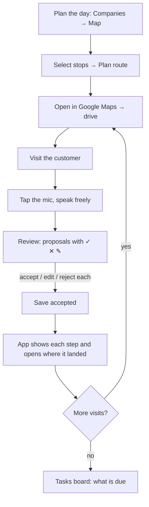

### A4.2 Central voice command

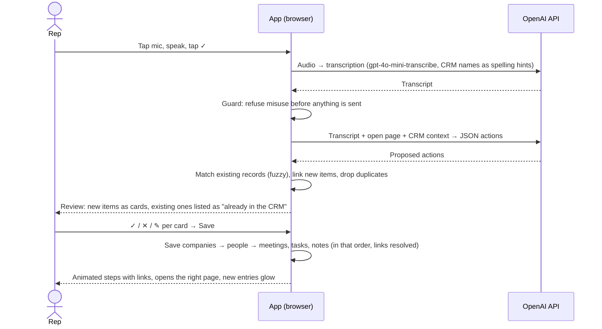

**Review rules**

- Every proposal starts undecided. ✓ accepts it (green), ✕ rejects it (crossed out), and tapping again undoes it. ✎ opens the form; Done accepts the edited version.
- **Save N** saves only accepted proposals. **Accept all** appears when several are undecided.
- "Already in the CRM?" offers likely existing matches for a new company or person. Picking one re-links every other proposal to it.

### A4.3 Duplicate and repeat handling

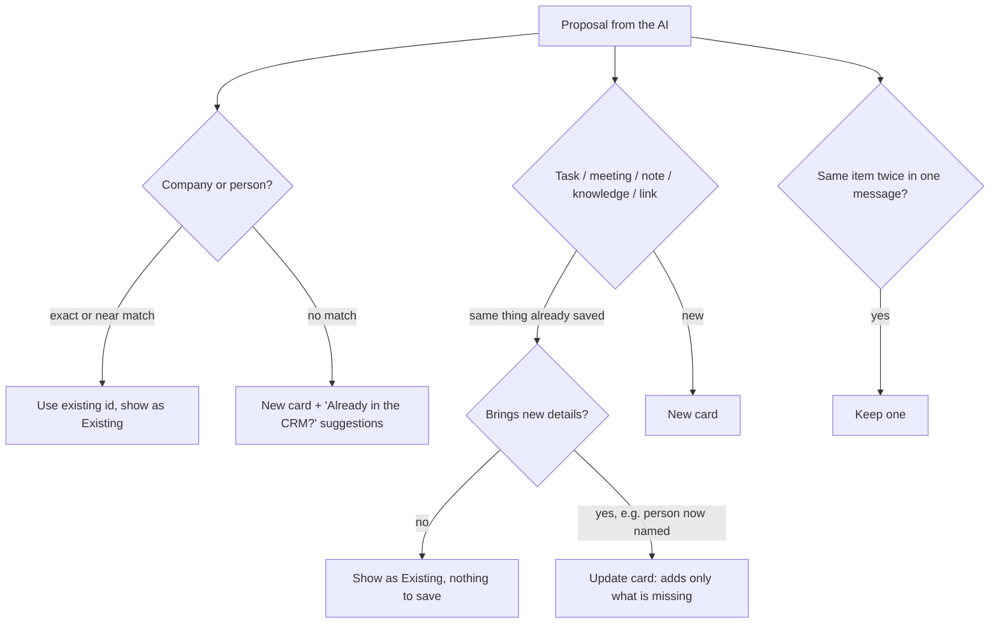

- **"Same" means:** same or similar wording (typos, word order), and the same company or person, or neither set. A task with the same title for a different company is a new task.
- **Example:** said twice, first without and then with the person's name ("Peter Müller from Glasbau Bern"). The second time, Peter Müller is created and **added** to the existing task and meeting.

### A4.4 Quote request to ERP

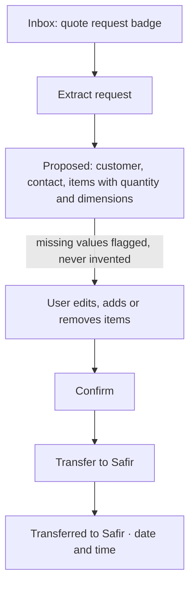

### A4.5 Route planning

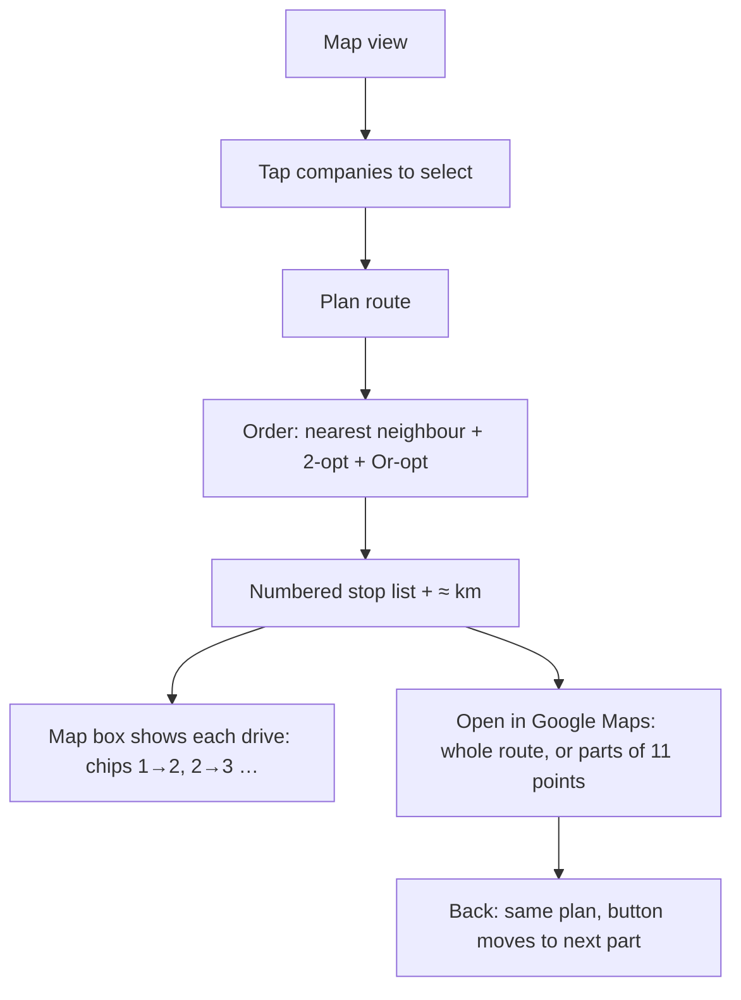

### A4.6 Ask (chat)

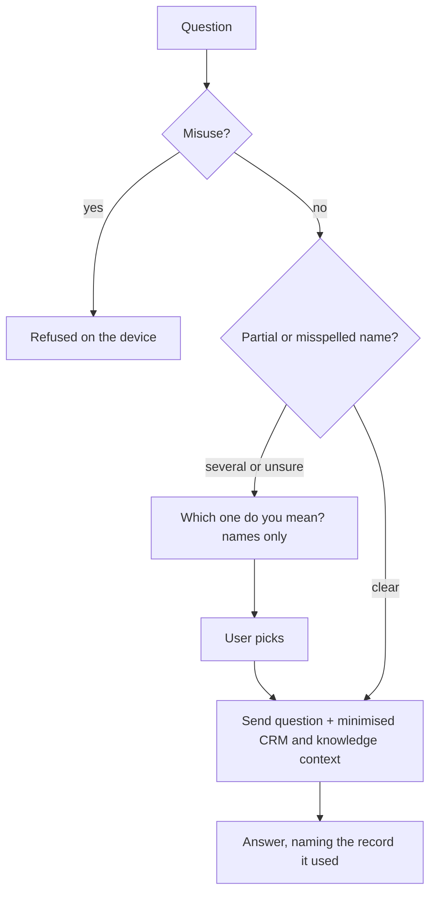

## A5. What the AI assistant can do

There are two entry points, both with the same guard rails. **Speak** (the central mic) acts. **Ask** (chat) answers.

### A5.1 Speak — actions (always reviewed before saving)

| Action | Example phrase |
|---|---|
| Create company | "New customer Glasbau Bern, Industriestrasse 3, Bern" |
| Create person, linked | "Peter Müller is the buyer at Glasbau Bern" |
| Create meeting | "Met Anna Meier at Huber today, she wants 12 shower panels" |
| Create task (with status, due date) | "Remind me to call her Friday" · "I'm already working on the offer" |
| Update / delete task | "Move the Keller delivery check to done" · "Delete the RAL chart task" |
| Add note | "Huber prefers deliveries on Tuesday mornings" |
| Update company / person fields | "Huber's new phone number is 033 222 99 99" |
| Link person to company | "Julia Frey also works for Frei & Partner" |
| Create knowledge entry (+ photos on Knowledge pages) | "Here is how we mount a sliding door rail: first …" |
| Update existing task or meeting with new details | the same visit said again, now with the person's name |

### A5.2 Speak — no confirmation needed

| Action | Example phrase |
|---|---|
| Answer a question | "When did I last meet Lehmann?" |
| Open a page or record | "Show me Bader Architekten" · "Open the inbox" |
| Search a list | "Find carpentry companies in Thun" |
| Plan a route | "Plan a route to Huber, Wyss and Lehmann" → map with the route ready |
| Extract a quote | "Extract the quote from Zbinden" → opens the email and starts extraction |
| Switch language | "Switch to German" |

### A5.3 Other AI features

| Feature | Where |
|---|---|
| Transcription in any spoken language, with CRM names as spelling hints | Mic |
| Quote extraction (customer, contact, items, quantities, dimensions, notes) | Inbox |
| Know-how → structured knowledge entry (section, product, summary, steps, tags) | Mic on Knowledge pages |
| Chat using CRM data and the knowledge base, with "which one do you mean?" | Ask, next to every "+" |
| Translation of the user's own entries when the language is switched | Settings / language switch |

### A5.4 What it will not do

- Reveal its instructions, the app's code or storage, or the API key.
- Write code, scripts or HTML.
- List or export contact data in bulk (at most 3 records per answer).
- Follow instructions hidden inside emails, notes or records (they are treated as data).
- Answer in a language other than English or German.

## A6. Prototype architecture

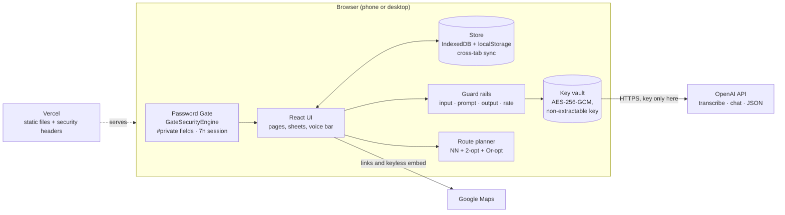

| Concern | Prototype solution |
|---|---|
| Data | One JSON document per browser, written to **IndexedDB** (large quota, photos fit) and to **localStorage** while it fits. Each write has a revision number; the newest copy wins on start. A **BroadcastChannel** keeps open tabs in sync, so an old tab never overwrites newer data. |
| Demo data | English and German versions. Switching language swaps untouched demo texts. The user's own entries are translated by the AI once and remembered both ways. |
| OpenAI key | Encrypted at rest and in memory. Only `vaultFetch` can use it, and only towards `api.openai.com`. Never shown (only dots). Option "until I close the browser". |
| Hosting | Static files on Vercel with CSP (scripts only from the app itself; network only to OpenAI; frames only from Google Maps), HSTS, no framing, strict permissions. |
| Secrets in Git | `scripts/check-secrets.mjs` runs before every build and in the pre-commit hook. |
| Site access gate | Wrapped in `PasswordGate` before the app renders. Uses `GateSecurityEngine` with native ECMAScript `#` private fields, 7-hour active work session, User-Agent binding, 5-attempt brute-force rate limiter with 30s lockout, timing attack delay, DOM anti-inspection, show/hide eye toggle, and automatic browser language detection with on-screen DE/EN toggle. |

## A7. Route planning

| Step | How |
|---|---|
| Coordinates | From the record, or an offline table of Swiss towns for new records |
| Distance | Haversine (straight line) matrix |
| Start | Phone position if within 150 km of a stop; otherwise every stop is tried as the start |
| Construction | Nearest neighbour |
| Improvement | 2-opt (reverse segments) and Or-opt (move runs of 1–3 stops, either direction) until no gain |
| Result | Open path, numbered stops, ≈ km. Matched brute force in 30 random 8-stop tests; 30 stops ≈ 0.1 s |
| Navigation | One Google Maps directions link with exact coordinates (origin + up to 9 waypoints + destination). Longer routes are split into parts that chain. |
| Preview | The keyless embed draws one drive at a time; chips switch drives |
| Coming back | The plan is kept for the tab; back returns to it and the button moves on to the next part |

## A8. Security and AI guard rails in the prototype

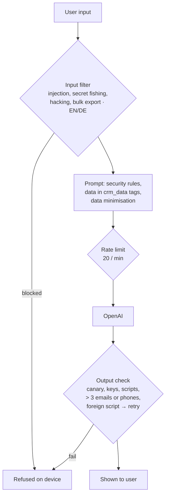

- **Data minimisation:** phone numbers, emails and addresses are sent to the AI only for the companies and people a question names.
- **Known limit (by design):** without a server, code running in the open app can use the key. Part B moves the key to the server.

### A8.1 Prototype site access gate security
To protect the publicly hosted prototype on Vercel from unauthorized access and automated web scrapers without requiring a full user database, the app wraps the UI in `<PasswordGate>` (`src/components/PasswordGate.tsx`):

1. **Encapsulation via ECMAScript `#` Private Fields:** All validation logic, cryptographic functions, and lockout tracking run within `GateSecurityEngine`. Private fields (`#targetHash`, `#storageKey`, `#lockoutKey`, `#maxAttempts`, `#sessionDurationMs`) are enforced at the JavaScript engine level (V8 / JavaScriptCore) and cannot be inspected or modified from the DevTools console.
2. **7-Hour Work Session:** A successful unlock grants access for 7 hours (`SEVEN_HOURS_MS`). Active listeners on `visibilitychange`, window `focus`, and a 60-second interval timer automatically re-lock the app if 7 hours elapse while a tab is kept open.
3. **Browser-Specific Signature:** The session is cryptographically bound to `navigator.userAgent`:
   $$\text{signature} = \text{SHA-256}(\text{hash} + \text{expiresAt} + \text{randomToken} + \text{userAgent} + \text{salt})$$
   Cloning or exporting `localStorage` to another browser or device invalidates the session immediately.
4. **Brute-Force Rate Limiting:** 5 consecutive failed attempts trigger an enforced 30-second lockout with a real-time countdown timer.
5. **Anti-Inspection Hardening:**
   - Input characters use CSS-level disc masking (`-webkit-text-security: disc`), preventing DevTools attribute changes from exposing the password.
   - DevTools keyboard shortcuts (`F12`, `Ctrl+Shift+I/J/C`, `Ctrl+U`) and context menus (`onContextMenu`) are blocked on the gate screen.
   - Clipboard copy/cut is disabled; password managers are ignored via `data-1p-ignore` and `data-lpignore`.
   - Constant-time artificial delay (350 ms) mitigates timing side-channel attacks.
   - Plaintext input is purged from memory and the DOM immediately upon form submission.
6. **Show/Hide Eye Reveal:** Accessible toggle button (`Eye` / `EyeOff` icons) allows users to verify characters before submitting.
7. **Bilingual Detection:** Checks `navigator.language` to present a full German page to German browsers and full English to all others, with an instant `[DE | EN]` on-screen switcher.

## A9. Languages

| What | Rule |
|---|---|
| UI | English and German dictionaries. Default follows the browser (German → DE, any other → EN) until the user picks one. |
| Demo data | Built-in EN and DE texts; untouched records switch. |
| User's own entries | Translated by the AI on switch, remembered both ways. Names, addresses, numbers and product codes are kept. |
| AI answers | German when the user asks in German, otherwise the app language. Any spoken language is understood. |

## A10. What is missing or simplified

| Item | Reason / next step |
|---|---|
| Backend, logins, sync between devices | Not allowed in the prototype → Part B |
| Real email, ERP, register and simap connections | Mockups by design → B8 |
| Road distance, traffic, opening hours in routing | Needs a server-side Google key → B8.3 |
| Geocoding new addresses | Needs a key → B8.3 |
| Offline recording queue | Next step after the backend |
| Automated tests in CI | Tested with Playwright scripts during development and manual scripts in `docs/`; CI suite planned in B12 |
| Key protection against code running in the app | Only solvable with a server → B7.2 |

---

# Part B — Backend and database architecture (plan only)

> Nothing in Part B is implemented. It describes how the CRM from Part A would run as a real product for many customer companies.

## B1. Key decisions at a glance

| Topic | Decision | Why |
|---|---|---|
| Shape | **Modular monolith**: one TypeScript API plus one background worker, same codebase | 500 users do not need microservices; one deployable is cheaper to run and easier to debug |
| Frontend | The existing React app, served as static files (PWA) | Already built; only the data layer changes from browser storage to API calls |
| Database | **PostgreSQL** (managed), one database | Relational data with many-to-many links; full-text and fuzzy search built in |
| Tenancy | **Shared schema, `tenant_id` on every row, Postgres Row-Level Security** | Strong isolation enforced by the database, one schema to migrate, cheap at 50 tenants |
| Files | S3-compatible object storage, per-tenant prefixes, signed URLs | Voice files and photos do not belong in the database |
| Jobs | Queue in Postgres (pg-boss) | Transcription, email sync and ERP transfer run in the background without another system to operate |
| Auth | Email magic link + passkeys, optional Microsoft 365 sign-in; sessions in HttpOnly cookies | Reps on phones hate passwords; Swiss SMEs mostly use Microsoft 365 |
| AI | All OpenAI calls on the server; key in a secret store; per-tenant quotas | The key never reaches a browser; usage is controlled and logged |
| Hosting | A Swiss region (Zurich/Geneva), managed services | Swiss customers, revDSG; low operating effort |
| Cost | ≈ CHF 650–1,200 / month all-in at 500 active users | See B9.3 |

## B2. Sizing assumptions

| Quantity | Assumption | Result |
|---|---|---|
| Tenants | 50 companies | — |
| Users | 5–10 per tenant | 250–500 users, ~150 active on a given day |
| Companies + people per tenant | 2,000 + 5,000 (after years) | ≤ 350,000 rows in total |
| Meetings | 5 per active user per day | ~750 / day, ~200,000 / year |
| Voice commands | 10 per active user per day × 30 s | ~1,500 / day ≈ 12.5 h of audio / day |
| Chat questions | 15 per active user per day | ~2,250 / day |
| Emails synced | 50 per tenant per day | ~2,500 / day |
| Peak load | 9–10 am and 4–6 pm | Well under 20 requests / s |
| Database size | Year 1 | < 10 GB (without files) |
| Object storage | Photos + 30 days of audio | < 200 GB |

**Conclusion:** a single small API server, a single managed Postgres and object storage carry this load with a large margin. Scaling up means a bigger instance, not a new architecture.

## B3. Overall architecture

### B3.1 Components

**Platform**

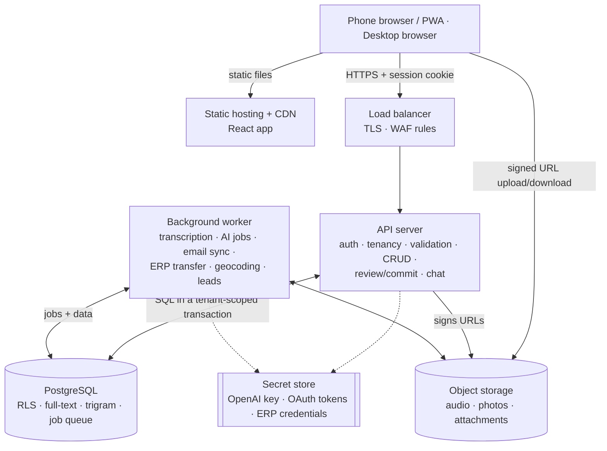

**Connections to outside services** (all from the server; the browser only opens Google Maps navigation links)

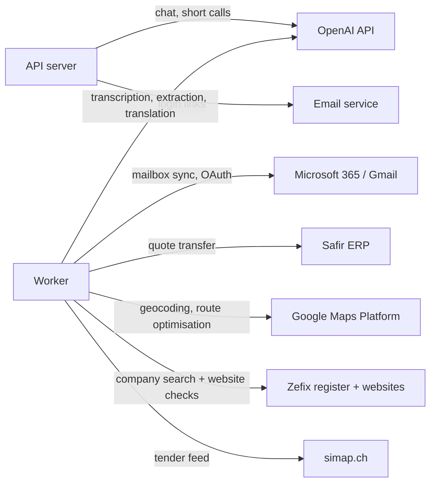

| Component | Responsibility | Talks to |
|---|---|---|
| React app (PWA) | UI as today; calls the API instead of browser storage; caches the last data for slow networks | API, Google Maps links |
| API server | Login and sessions, tenant resolution, validation, CRUD, review and commit of proposals, chat, signed URLs | Postgres, object storage, OpenAI, secret store |
| Worker | Long or retryable jobs: transcription, interpretation of long audio, email sync, quote extraction, ERP transfer, geocoding, lead checks, cleanup | Postgres (queue), object storage, external APIs |
| PostgreSQL | All business data, sessions, audit log, job queue | API, worker |
| Object storage | Audio, photos, email attachments; encrypted at rest; lifecycle rules | API (signed URLs), worker |
| Secret store | Provider keys and per-tenant integration credentials | API, worker |

### B3.2 How they talk

| From → to | Protocol | Notes |
|---|---|---|
| Browser → API | HTTPS REST/JSON | Session cookie (HttpOnly, Secure, SameSite=Lax), CSRF token on writes |
| Browser → object storage | HTTPS PUT/GET to **signed URLs** (5 min) | Audio uploads go directly to storage, not through the API |
| API ↔ worker | Jobs in Postgres (pg-boss) | Retries with backoff, dead-letter, idempotency keys |
| Worker → UI | The browser polls the job status (or server-sent events) | Simple, works through every proxy |
| API/worker → external | HTTPS with per-provider timeouts and circuit breakers | Credentials from the secret store |

### B3.3 Voice command in production

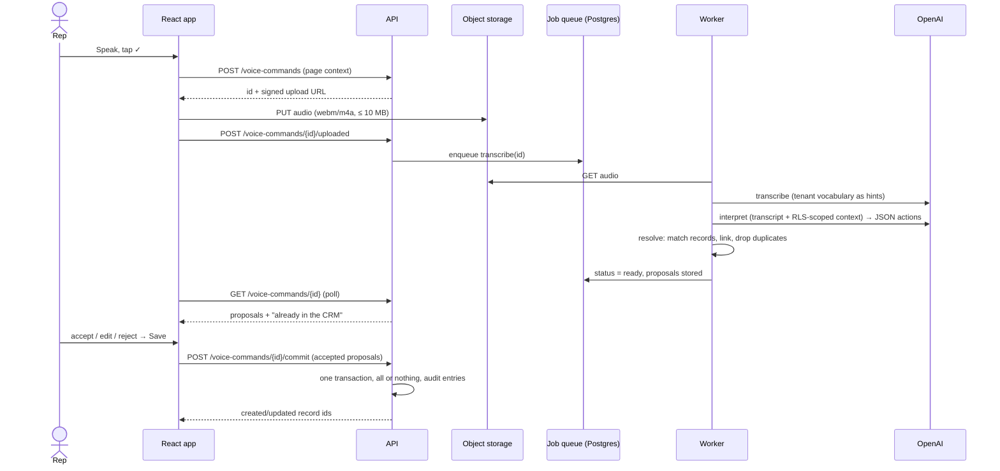

**Why the worker:** transcription takes several seconds and must survive a dropped phone connection. The rep can lock the phone; the proposals are waiting when they come back.

**Why one transaction:** a meeting must never be saved without its new person. The commit is all-or-nothing, and it uses idempotency keys so a double tap does not save twice.

## B4. Database schema

### B4.1 Entity–relationship diagrams

Overview of all tables and their relations. Every table except `tenant` carries `tenant_id` (B5); it is left out of the detailed diagrams below to keep them readable.

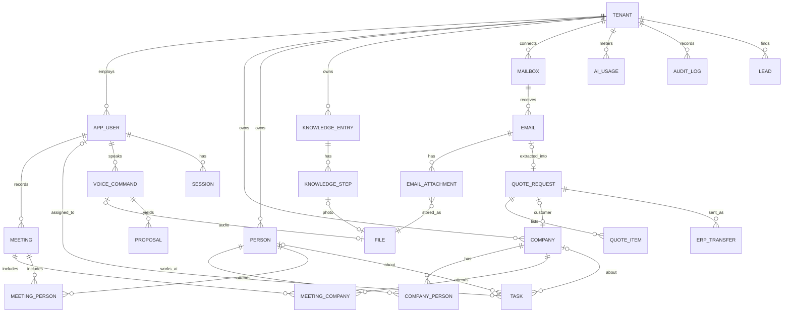

The same tables with their key fields, by area. A table already detailed in an earlier diagram appears without its fields.

**Contacts, meetings and tasks (the core)**

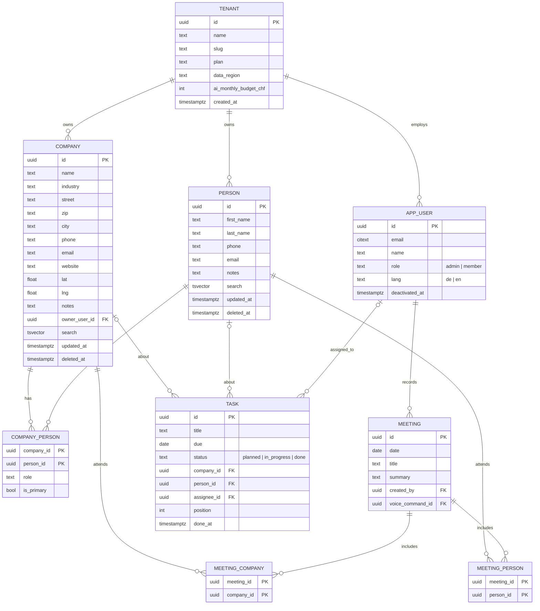

**Knowledge base and files**

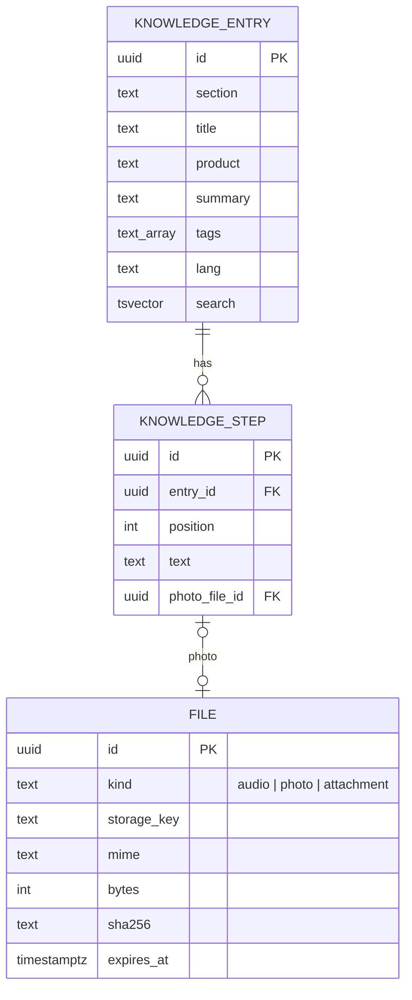

**Inbox, quote requests and ERP transfer**

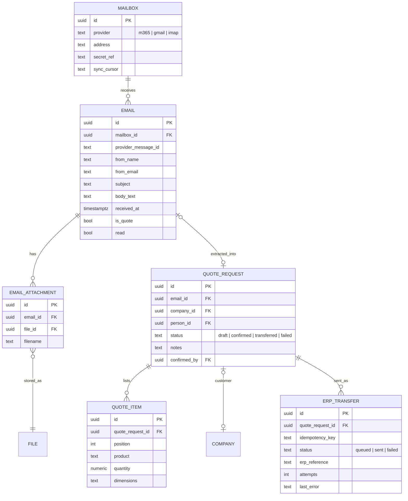

**Voice, AI usage, audit, leads and sessions**

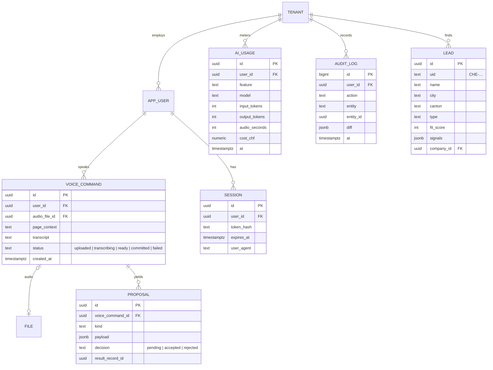

### B4.2 Tables

| Table | Purpose | Key fields | Relations and constraints |
|---|---|---|---|
| `tenant` | A customer company of the product | `name`, `slug`, `plan`, `ai_monthly_budget_chf` | Root of everything; no `tenant_id` |
| `app_user` | A login | `email` (unique per tenant), `role`, `lang` | → tenant. Deactivated, never deleted (audit) |
| `session` | Active logins | `token_hash`, `expires_at` | → app_user. Only a hash of the token is stored |
| `company` | Customer or prospect of the tenant | name, address, contact, `lat/lng`, `notes`, `search` | Unique `(tenant_id, lower(name), zip)` against duplicates. Soft delete |
| `person` | Contact person | name, phone, email, `notes` | Soft delete |
| `company_person` | **Many-to-many** person ↔ company | `role` per company, `is_primary` | PK `(company_id, person_id)`; composite FKs include `tenant_id` |
| `meeting` | What was discussed | `date`, `title`, `summary`, `created_by`, `voice_command_id` | Participants via the two join tables |
| `meeting_company`, `meeting_person` | Participants (many-to-many) | — | PK per pair; composite FKs |
| `task` | To-do | `title`, `due`, `status`, `position`, `done_at` | Optional company, person, assignee. Index `(tenant_id, status, due)` |
| `knowledge_entry` | Tutorial or know-how | `section`, `title`, `product`, `summary`, `tags`, `lang` | Full-text index; optional embedding later |
| `knowledge_step` | One step of a tutorial | `position`, `text`, `photo_file_id` | Ordered by `position` |
| `file` | Metadata of a stored object | `kind`, `storage_key`, `mime`, `bytes`, `sha256`, `expires_at` | Object at `tenants/{tenant_id}/{kind}/{id}` |
| `mailbox` | A connected mailbox | `provider`, `address`, `secret_ref`, `sync_cursor` | Tokens live in the secret store; only a reference here |
| `email` | A synced message | sender, subject, body text, `is_quote` | Unique `(mailbox_id, provider_message_id)` → sync is idempotent |
| `email_attachment` | Attachment of an email | `filename`, `file_id` | → email, → file |
| `quote_request` | Extracted and confirmed request | `status`, customer and contact links, `notes` | One per email |
| `quote_item` | One requested line | `product`, `quantity`, `dimensions` | Ordered |
| `erp_transfer` | Hand-over attempt to Safir | `idempotency_key`, `status`, `erp_reference`, `attempts`, `last_error` | Outbox pattern; retried by the worker |
| `voice_command` | One spoken command | `audio_file_id`, `transcript`, `status`, `page_context` | Audio expires (B7.4) |
| `proposal` | One proposed action and the user's decision | `kind`, `payload` (jsonb), `decision`, `result_record_id` | Keeps the review traceable |
| `ai_usage` | Metering per call | feature, model, tokens, audio seconds, cost | Quotas and invoicing |
| `audit_log` | Who changed what | action, entity, diff | Append-only; 1 year |
| `lead` | Lead search result | `uid` (CHE number), type, `fit_score`, `signals` | Optional link to the company once added |

**Conventions**

- **Identifiers and audit fields:** UUID v7 primary keys (time-ordered, safe to expose). `created_at`, `updated_at` and `created_by` on every business table.
- **Tenant on every row:** every business table has `tenant_id NOT NULL`. Foreign keys are composite, `(tenant_id, x_id)` → `(tenant_id, id)`, so a row can never point at another tenant's record, even through a bug.
- **Search:** generated `tsvector` columns (German + English configurations) and `pg_trgm` indexes on names. These give the fuzzy "Hubr → Huber" matching the voice command needs.
- **Deletes:** soft delete (`deleted_at`) for companies and people, so links in old meetings survive; hard delete on GDPR/revDSG request.

### B4.3 Why `role` moves to the link

In the prototype a person has one `role`. In reality a freelance installer is "installer" at one company and "partner" at another, so the role lives on `company_person`. The person card shows the role of the company it is opened from.

## B5. Multi-tenancy

### B5.1 Options

| Option | Isolation | Operations at 50 tenants | Cost | Verdict |
|---|---|---|---|---|
| Database per tenant | Strongest | 50 databases to migrate, back up and monitor | High | Over-engineered for this size |
| Schema per tenant | Strong | 50 schemas per migration; connection pooling gets awkward | Medium | Possible, but no real gain over RLS |
| **Shared schema + `tenant_id` + Row-Level Security** | Strong, enforced by Postgres | One schema, one migration, one backup | Low | **Chosen** |
| Shared schema, filtering only in application code | Weak: one forgotten `WHERE` leaks data | Easy | Low | Rejected |

### B5.2 How it works

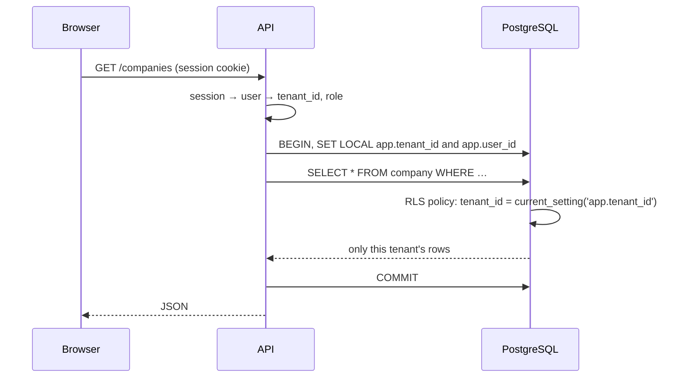

**Rules**

1. **The tenant comes from the session only.** Never from a URL, header or request body.
2. **RLS on every table that has `tenant_id`:** `USING (tenant_id = current_setting('app.tenant_id')::uuid)` with the same `WITH CHECK`, so writes are scoped too.
3. **The app connects as a role without `BYPASSRLS`** and is not the table owner. Migrations run as a separate role.
4. **`SET LOCAL` inside every transaction.** With connection pooling, a setting can never leak to the next request.
5. **Composite foreign keys** (B4.2) as a second line of defence.
6. **Object storage:** keys are prefixed with `tenants/{tenant_id}/`, and only the API issues signed URLs, after checking the tenant.
7. **Jobs carry `tenant_id`;** the worker sets the same context before touching data.
8. **AI context is built from RLS-scoped queries,** so a prompt can only ever contain the caller's tenant's data.
9. **Tests:** every endpoint runs in CI against two tenants with similar data, and asserts that tenant B sees nothing of tenant A.
10. **Platform support access** (our staff) is a separate, audited role, time-limited and approved by the tenant admin.

**Why this choice:** one database is the right size for 500 users. RLS makes isolation a property of the database instead of a coding convention. If one tenant ever needs physical separation (an enterprise contract), that tenant can be moved to its own database with the same schema.

## B6. Authentication and roles

### B6.1 Login

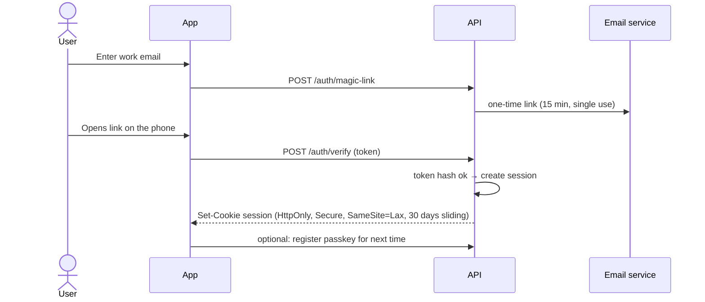

| Method | For whom |
|---|---|
| Magic link by email | Default, works for everyone |
| Passkey (Face ID / fingerprint) | Fast daily login on the phone after the first time |
| Microsoft 365 / Google sign-in (OIDC) | Tenants that use them; the admin can make it mandatory |
| Second factor | Required for admins (passkey or TOTP) |

**Session rules**

- Sessions last 30 days, sliding. The rep should not log in again in a car park.
- Sessions can be revoked: a user can sign out everywhere, and an admin can deactivate a user immediately.
- Rate limits and short lockouts apply on login endpoints.
- **Implementation:** a well-tested auth library or a hosted identity provider with EU/CH data location. No hand-rolled crypto.

### B6.2 Roles

| Permission | Member | Admin | Platform support |
|---|---|---|---|
| Read and edit companies, people, meetings, tasks, knowledge | ✅ | ✅ | Only with approved, audited access |
| Use voice command, chat, route planning | ✅ | ✅ | — |
| Delete companies and people | Own records | ✅ | — |
| Confirm a quote and transfer to the ERP | ✅ | ✅ | — |
| Invite, deactivate users, change roles | — | ✅ | — |
| Connect mailboxes, ERP, Microsoft 365 | — | ✅ | — |
| AI budget, data retention, export all data | — | ✅ | — |
| See audit log | — | ✅ | ✅ (support case) |
| Create tenants, billing | — | — | ✅ |

Two tenant roles are enough at this size. Fine-grained permissions ("only my own customers") can be added later as an RLS policy on `owner_user_id`, if a tenant asks for it.

## B7. AI features

### B7.1 Where the calls happen

| Feature | Called by | Sync / async | Model (example) | Context sent |
|---|---|---|---|---|
| Transcription | Worker | Async | gpt-4o-mini-transcribe (fallback whisper-1) | Audio + tenant vocabulary (company and person names) |
| Voice → proposals | Worker | Async (after transcription) | gpt-4o-mini, JSON mode | Transcript, open page, matching records found by search |
| Chat (Ask) | API | Sync, streamed | gpt-4o-mini | Question, chat history, records and knowledge found by search (RAG) |
| Quote extraction | Worker | Async, on email arrival or click | gpt-4o-mini, JSON mode | One email body |
| Knowledge entry from speech | Worker | Async | gpt-4o-mini, JSON mode | Transcript (+ photo references) |
| Translation of own entries | Worker | Async, on language switch | gpt-4o-mini | Changed text fields only |
| Lead website check | Worker | Async, batch | gpt-4o-mini | Public website text |

**The big change from the prototype:** the server builds the context with **search instead of sending the whole CRM**. It runs full-text plus trigram search over names, and optionally vector search over the knowledge base. Prompts stay small, cost stays predictable, and only relevant records leave the database.

### B7.2 Protecting the API key

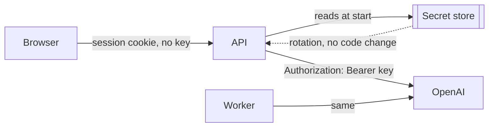

- **Where the key lives:** only in the secret store and in the server's memory. It is never in the browser, the repository, logs or error messages.
- **Separate keys and spend caps:** one key per environment (staging, production) with a spending cap on the provider side. Rotation takes one secret update.
- **Per-tenant quotas** in `ai_usage`: a monthly budget per tenant and a per-user rate limit (e.g. 30 requests per minute). Alerts at 80 % of the budget.
- **The guard rails from the prototype move to the server:** input filter, shared rules, the `<crm_data>` boundary, output checks and the canary. On the server they cannot be bypassed by editing the browser.
- **Contract and data handling:** a DPA with the AI provider, zero data retention where offered, and EU/Swiss data residency where available. Alternative: the same models via Azure OpenAI in Switzerland North, if the client requires data to stay in Switzerland. Check which models are offered in that region.

### B7.3 Voice files

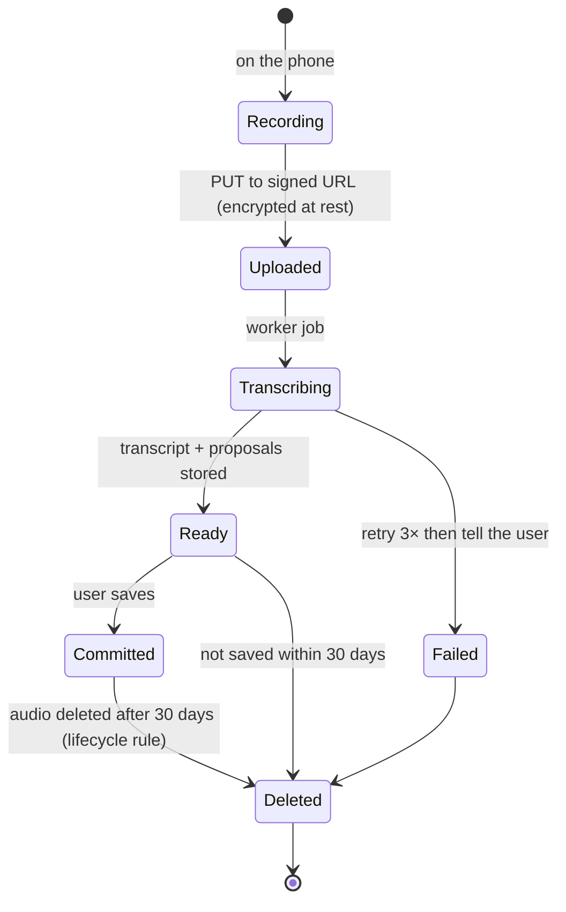

| Question | Answer |
|---|---|
| Format | WebM/Opus (Android, desktop) or M4A/AAC (iPhone), max. 10 MB (≈ 10 min) |
| Upload | Directly from the phone to object storage via a signed URL; the API never buffers audio |
| Encryption | TLS in transit; server-side encryption at rest; bucket not public |
| Retention | **Transcript is kept** (it is the record of what was said). **Audio is deleted after 30 days**; tenants can choose 0–90 days |
| Access | Only the speaker and tenant admins, through signed URLs valid for 5 minutes |
| Sent to the AI provider | Once, for transcription; no retention at the provider (contract) |
| Offline | Later: the PWA queues the recording and uploads it when the phone is back online |

## B8. Integrations

### B8.1 Email inbox

```mermaid
sequenceDiagram
    participant Admin
    participant API
    participant M as Microsoft 365 / Gmail
    participant W as Worker
    participant OAI as OpenAI
    Admin->>API: Connect mailbox (OAuth consent, read-only scope)
    API->>M: OAuth → tokens → secret store
    M-->>API: Webhook: new message (or worker polls every 2 min)
    API->>W: enqueue sync(mailbox)
    W->>M: Fetch new messages since cursor
    W->>W: Store email (idempotent on message id), attachments → storage
    W->>OAI: Is this a quote request? (cheap classification)
    W->>W: Mark is_quote, link sender to company/person
    Note over W: Extraction runs when the user taps Extract (or automatically)
```

- **Preferred:** Microsoft Graph or the Gmail API with OAuth and read-only scopes, using one shared sales mailbox per tenant. **Fallback:** IMAP over TLS with an app password.
- **Linking:** emails are linked to known companies and people by sender address and domain.
- **Data kept:** only the text body and attachments are stored; no tracking pixels are loaded. Retention is configurable (e.g. 12 months).

### B8.2 ERP transfer (Safir)

```mermaid
flowchart LR
    C[User confirms quote] --> O[(erp_transfer row<br/>status queued<br/>idempotency key)]
    O --> W[Worker]
    W --> A{Safir interface}
    A -->|REST/SOAP API| S[Safir]
    A -->|file drop: CSV/XML via SFTP| S
    S -->|reference number| W
    W --> D[status sent + erp_reference]
    W -->|error| R[retry with backoff → failed → notify user]
```

- **Outbox pattern:** the transfer is written in the same transaction as the confirmation. It is never lost, and the idempotency key prevents duplicate quotes in Safir.
- **Adapter:** the Safir interface is still unknown (open question). The adapter is one module, so changing from a file export to an API does not touch the rest.
- **Mapping:** product names → Safir article numbers come from a mapping table per tenant, maintained by the admin. Unknown products are sent as free-text lines.

### B8.3 Google Maps

| Use | How | Key |
|---|---|---|
| Navigation | Directions links as in the prototype (`google.com/maps/dir/?api=1…`) | None |
| Map in the app | Maps Embed or Maps JavaScript API | Browser key, restricted to the app's domain |
| Geocoding new addresses | Worker calls the Geocoding API when an address is saved and stores `lat/lng` | Server key in the secret store |
| Better route order | Optional: Routes API with waypoint optimisation (road distance, traffic), called by the API; the prototype's algorithm stays as the offline fallback | Server key |

Cost control: geocoding happens once per address, not per view. Route optimisation runs only when the user plans a route.

### B8.4 Lead search

```mermaid
flowchart TB
    Q[Criteria: region, type, size, website] --> Z[Zefix public REST API<br/>Swiss commercial register]
    Z --> F[Filter: legal form, purpose text, canton, active]
    F --> Web[Worker fetches the website<br/>robots.txt respected, rate limited]
    Web --> AI[AI: classify business, signals<br/>e.g. 'glass doors', 'renovation']
    AI --> S[fit score]
    S --> L[(lead table)] --> U[Result list → Add as company]
```

- **Sources:** Zefix (official, free, company name, UID, seat, purpose) is the source of truth. Websites are checked by the worker in batches, never during the user's request. Results are cached for 30 days.
- **Data protection:** only company data is collected, no personal data beyond what the register publishes.

### B8.5 simap Bot (later)

A scheduled worker job reads new public tenders from simap.ch (interface or notification feed to be confirmed). It filters them by CPV codes and keywords for glass and facades, and lists matches in the simap tab. It is not part of the first release.

## B9. Hosting and operations

### B9.1 Deployment

```mermaid
flowchart TB
    subgraph CH["Swiss cloud region (Zurich / Geneva)"]
        subgraph Prod
            LB[Load balancer + TLS]
            API1[API container]
            API2[API container<br/>second instance]
            WK[Worker container]
            PGP[(PostgreSQL primary)]
            PGS[(Standby replica)]
            OBJ[(Object storage)]
        end
        subgraph Staging
            STG[API + worker + small Postgres]
        end
        BK[(Backups: PITR + daily snapshots<br/>second Swiss location)]
    end
    GH[GitHub: CI tests, build, migrations] -->|deploy| Prod
    GH -->|deploy| Staging
    LB --> API1 & API2
    API1 & API2 & WK --> PGP
    PGP -. streaming .-> PGS
    PGP -. WAL + snapshots .-> BK
    OBJ -. versioning + replication .-> BK
```

**Where it runs**

- **Provider:** a provider with Swiss data centres and managed Postgres, containers and object storage. Candidates are Infomaniak, Exoscale, or the Zurich regions of AWS, Azure or Google Cloud. The choice depends on the client's preference and existing contracts; the architecture is the same on all of them.
- **App containers:** two small API instances (rolling deploys without downtime) and one worker.
- **Database:** managed PostgreSQL 16 with a standby replica. Failover is automatic.
- **Frontend:** static files from the same region's CDN, or Vercel with only static files, since no data passes through it.

**Backups and recovery**

| What | How | Target |
|---|---|---|
| Database | Point-in-time recovery for 14 days and a daily snapshot kept 35 days, copied to a second Swiss location | RPO ≤ 5 min, RTO ≤ 4 h |
| Object storage | Versioning plus replication to a second location | Deleted files recoverable for 30 days |
| Restore test | Monthly, restore to staging and check | Proven, not assumed |
| Tenant export | Admin can export all data (JSON + files) | Portability, offboarding |

**Operations**

- **CI on every push:** type check, lint, unit tests, tenant isolation tests, migration dry-run.
- **Deploys:** staging first, then production. Migrations are forward-only and backwards-compatible (expand → migrate → contract).
- **Monitoring:**
  - Uptime checks and error tracking.
  - Metrics: latency, job queue length, AI cost per tenant per day.
  - Alerts go to email/Slack.
- **Logs:** structured, 30 days. No message bodies, transcripts or keys in logs; IDs only.
- **Availability target:** 99.5 % during Swiss business hours. Maintenance windows run at night.

### B9.2 Environments

| Environment | Purpose | Data |
|---|---|---|
| Local | Development | Seed data (the prototype's EN/DE sample data) |
| Staging | Test every change, restore tests | Synthetic data only |
| Production | Customers | Real data, Switzerland only |

### B9.3 Rough monthly cost

The figures are estimates in CHF at 500 users, about 150 of them active per day. Prices vary by provider; AI prices are list prices at the time of writing.

| Item | Size | CHF / month |
|---|---|---|
| API containers | 2 × (1 vCPU, 2 GB) | 40–80 |
| Worker container | 1 × (1 vCPU, 2 GB) | 20–40 |
| Managed PostgreSQL with standby | 2 vCPU, 8 GB, 100 GB SSD | 180–350 |
| Object storage + traffic | ≤ 200 GB | 10–25 |
| Backups (extra location) | | 15–30 |
| Load balancer, CDN, DNS | | 20–40 |
| Monitoring, error tracking, logs | | 0–50 |
| Transactional email (login links) | | 0–15 |
| Staging environment | small | 40–80 |
| Google Maps Platform (geocoding, optional routes) | mostly within the monthly free credit | 0–50 |
| **Infrastructure subtotal** | | **≈ 325–760** |
| OpenAI transcription | ~12.5 h audio/day × 22 days ≈ 16,500 min | 50–100 |
| OpenAI text (interpretation, chat, extraction) | ~4,000 calls/day, small prompts thanks to search | 100–300 |
| **AI subtotal** | | **≈ 150–400** |
| **Total** | | **≈ 650–1,200 / month ≈ CHF 1.30–2.40 per user** |

Biggest levers: the AI prompt size (search, not whole-CRM context) and the database size (start without a standby and add it once paying customers rely on it).

## B10. Data protection

| Topic | Plan |
|---|---|
| Law | Swiss revDSG (nFADP); GDPR where EU persons are concerned |
| Data location | Database, files and backups in Switzerland. AI processing at a provider with a DPA, zero retention and EU/CH residency where offered, or Azure OpenAI Switzerland North |
| Subprocessors | Listed per tenant (cloud provider, AI provider, email service, Google Maps), with DPAs |
| Roles | The tenant is the controller of its customer data; we are the processor (DPA with each tenant) |
| Minimisation | Only relevant records go into AI prompts. Audio is deleted after 30 days. Logs carry no content |
| Rights of persons | Export and delete per person; deletion also removes their audio, emails and AI usage references |
| Tenant offboarding | Full export, then deletion within 30 days, including backups as they expire |
| Records of processing | Maintained for the platform |
| Breach handling | Incident runbook; notify the FDPIC and tenants as required |

## B11. Security

| Layer | Measures |
|---|---|
| Transport | TLS everywhere, HSTS, secure cookies |
| Browser | Strict CSP as in the prototype, CSRF tokens, no third-party scripts |
| API | Input validation with typed schemas on every endpoint, rate limits per user and IP, request size limits |
| Data | RLS, composite foreign keys, encryption at rest, separate DB roles |
| Secrets | Secret store, rotation, no secrets in code (secret scanning in CI as in the prototype) |
| AI | Server-side guard rails, quotas, prompt-injection boundary, output checks |
| Files | Signed URLs, MIME and size checks, image re-encoding (as the prototype does), malware scan for attachments |
| People | Admin 2FA, audited support access, least privilege for staff |
| Process | Dependency updates (Renovate), yearly external penetration test once live |

## B12. What to build first

```mermaid
flowchart LR
    subgraph S1["1. Foundation (3 wks)"]
        F1["Auth · Tenants · RLS<br/>CI with isolation tests · Staging"]
    end
    subgraph S2["2. Core Workflow (3 wks)"]
        F2["Contacts · Meetings · Tasks API<br/>App switches to API"]
    end
    subgraph S3["3. Voice on Server (3 wks)"]
        F3["Audio upload · Whisper job<br/>Proposals · 1-transaction commit"]
    end
    subgraph S4["4. Knowledge & Chat (2 wks)"]
        F4["Knowledge base with S3 photos<br/>RAG chat with search context"]
    end
    subgraph S5["5. Integrations (3 wks)"]
        F5["M365/Gmail sync · Quote extraction<br/>Safir ERP adapter · Route geocoding"]
    end
    subgraph S6["6. Later Additions (4 wks)"]
        F6["Zefix lead search · simap bot<br/>Offline recording PWA"]
    end
    S1 --> S2 --> S3 --> S4 --> S5 --> S6


```

| Order | Item | Why first |
|---|---|---|
| 1 | Auth, tenants, RLS, CI with isolation tests, staging, backups | Everything else depends on safe separation |
| 2 | Contacts, meetings, tasks on the API; the app switches from browser storage to the API | The core daily workflow; the brief ranks it highest |
| 3 | Voice command on the server: upload, transcription job, proposals, one-transaction commit | The main differentiator; needs the server to protect the key |
| 4 | Knowledge base with photos, chat with search-based context | Technicians and reps use it daily |
| 5 | Email sync and quote extraction | Saves office time; depends on mailbox access from the client |
| 6 | Safir transfer | Depends on knowing Safir's interface |
| 7 | Geocoding, server-side route optimisation | Small, improves an existing feature |
| 8 | Lead search, simap bot, offline recording | Valuable but not needed on day one |

## B13. Deliberately left out at this scale

| Left out | Why | When it would make sense |
|---|---|---|
| Microservices, Kubernetes | One API and one worker are enough; Kubernetes would cost more to run than the app | Several teams, or >10× the load |
| Database per tenant | RLS gives strong isolation with one schema to run | An enterprise tenant demands physical separation |
| Separate search cluster (Elasticsearch) | Postgres full-text + trigram cover names and knowledge | Millions of documents or complex relevance tuning |
| Message broker (Kafka, RabbitMQ) | The job queue in Postgres handles thousands of jobs per day | Very high job volume or many consumers |
| Multi-region, active-active | Customers are in Switzerland; a standby replica + backups meet the targets | Customers abroad, or a 99.9 %+ SLA |
| Native mobile apps | The PWA covers the mic, the camera and Google Maps links | Push-heavy or background-recording features |
| Real-time collaboration (live cursors) | Small teams rarely edit the same record at once; optimistic locking (`updated_at`) is enough | Many users on the same records |
| Own speech or language models | Provider models are better and cheaper at this size | Very high volume or strict on-premise needs |
| Full offline sync with conflict resolution | Complex; reps have mobile data | Customers in areas without coverage |
| Event sourcing / CQRS | The audit log gives the history that is needed | Never at this scale |

## B14. Risks and open questions

| # | Question / risk | Impact | Proposal |
|---|---|---|---|
| Q1 | Which interface does **Safir** offer (API, file import, version)? | ERP transfer design | Ask the client for Safir documentation and a test system |
| Q2 | Which mail system do the tenants use (Microsoft 365, Gmail, other)? | Email integration effort | Start with Microsoft 365, IMAP as fallback |
| Q3 | Must AI processing stay in Switzerland? | Provider choice | Azure OpenAI Switzerland North, or OpenAI with EU residency and zero retention |
| Q4 | May reps see all customers of their company, or only their own? | Roles, RLS | Default: all; add an "own customers" policy if needed |
| Q5 | How long must audio and emails be kept? | Storage, data protection | Default: audio 30 days, emails 12 months, configurable |
| Q6 | Is offline recording needed (no mobile coverage in valleys)? | PWA work | Measure in pilots, then decide |
| R1 | Speech recognition of Swiss German dialect | Wrong proposals | Review step stays mandatory; tenant vocabulary as hints; measure accuracy in pilots |
| R2 | AI cost spikes from one tenant | Margin | Per-tenant budgets and alerts |
| R3 | AI provider outage | Voice and chat unavailable | Manual forms always work; jobs retry; secondary model as fallback |

---

## Appendix: prototype → production mapping

| Prototype (browser) | Production |
|---|---|
| `src/store/db.ts` (IndexedDB + localStorage) | API + PostgreSQL; the app keeps a small cache |
| Seed data (EN/DE) | Onboarding sample tenant for demos and staging |
| `src/lib/keyVault.ts` | Secret store on the server; the browser never holds a key |
| `src/lib/openai.ts` | Server-side AI client with quotas and usage metering |
| `src/lib/guard.ts` | Same rules, enforced on the server |
| `src/lib/interpret.ts` (`resolve`, duplicate check) | Worker job; matching runs as SQL (trigram, full-text) inside the tenant |
| `src/lib/assistant.ts` (context building) | Search-based retrieval (RAG), RLS-scoped |
| `src/lib/route.ts` | Stays in the app (works offline); optional Routes API refinement |
| `src/lib/geo.ts` offline town table | Geocoding API on save |
| Inbox sample emails | Mailbox sync (Microsoft Graph / Gmail / IMAP) |
| "Transfer to Safir" (simulated) | Outbox + Safir adapter |
| Lead search static results | Zefix + website checks in the worker |
| `vercel.json` security headers | Same headers on the production CDN and API |
